# 电动自行车智能充电管理系统

**Smart E-Bike Charging Management System**

[](https://github.com/ifox-hu/campus-ebike-charging-admin/actions/workflows/pages.yml)


面向**校园、住宅小区、园区**等电动自行车集中充电场景的前后端分离项目，包含 **Vue 3 + Vite 管理端、Spring Boot 后端、uni-app 用户端**。站点按“**站点 → 多排设备 → 每台设备两个独立插座 A/B**”组织。

**[在线演示](https://ifox-hu.github.io/campus-ebike-charging-admin/) · [部署说明](docs/deployment.md) · [问题反馈](https://github.com/ifox-hu/campus-ebike-charging-admin/issues)**

> 在线页面是公开静态演示，演示账号 `demo`、密码 `Demo@123456`（仅模拟登录流程，并非真实身份认证）；业务、资料、通知与设置只保存在访问者自己的浏览器，不控制真实充电设备，不发生真实付款。
>
> 项目按 `frontend/`、`backend/`、`uni-app/` 分目录组织。H5 与微信小程序共用源码；管理演示、独立账号模式和统一业务模式分别运行。

## 目录

- [项目预览](#项目预览)
- [项目特点](#项目特点)
- [适用场景](#适用场景)
- [功能模块](#功能模块)
- [技术与架构](#技术与架构)
- [业务交互流程](#业务交互流程)
- [快速开始](#快速开始)
- [核心数据关系](#核心数据关系)
- [目录结构](#目录结构)
- [许可说明](#许可说明)

## 项目预览

### 管理端

演示账号：**`demo` / `Demo@123456`**。支持填入演示账号、显示密码、记住账号及退出登录。

| 在线演示登录 | 运营数据统计与高德地图 |
| --- | --- |
| 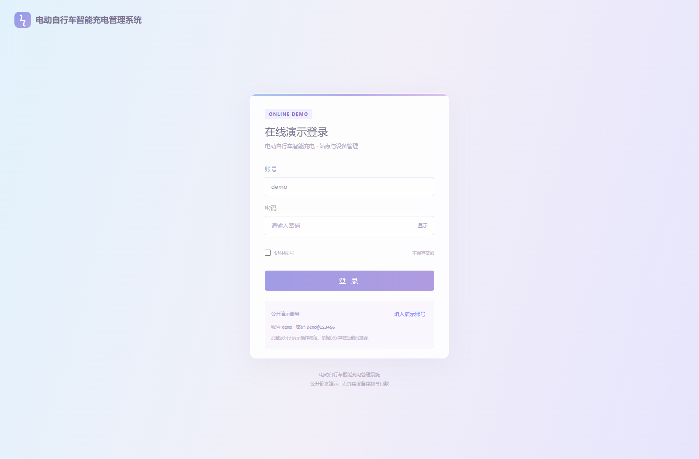 | 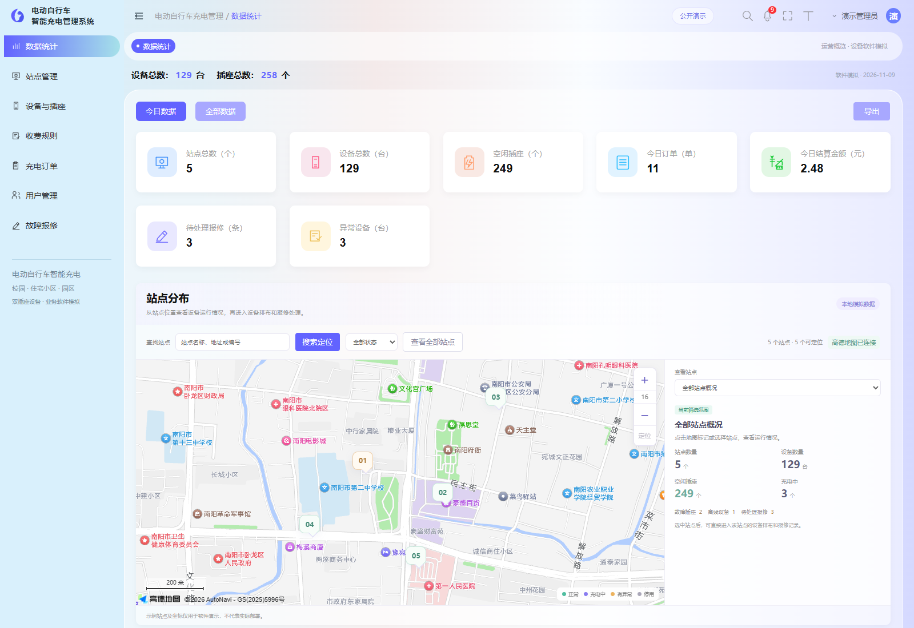 |
| **设备排布与 A/B 插座** | **充电订单管理** |
| 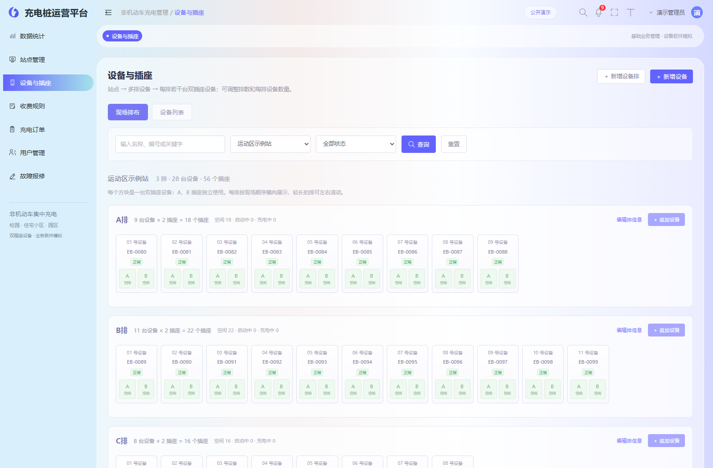 | 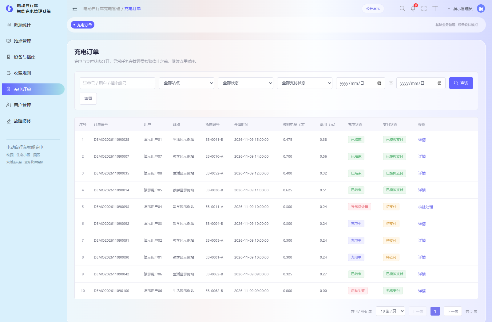 |

### 小程序用户端

配套用户端采用 uni-app，共用页面可构建为 H5 和微信小程序。以下是实际运行的 **H5 预览截图**，并非微信真机截图；用户端源码位于 `uni-app/`。截图使用通用演示数据，不展示具体学校楼栋或坐标。截图来源与复现方式见 [展示说明](docs/showcase.md)。

| 找站与空闲筛选 | 设备排布与插座 |
| --- | --- |
| 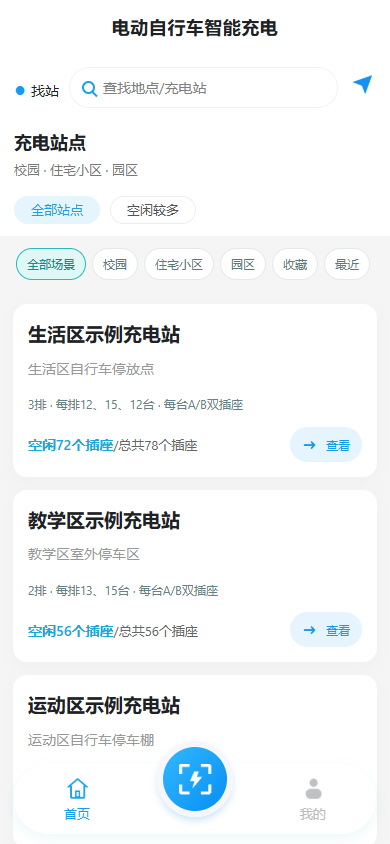 | 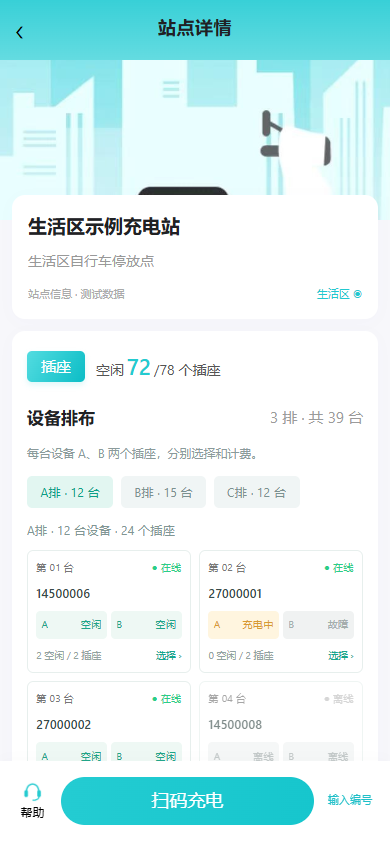 |
| **五种充电方式与预计金额** | **充电中与实时费用** |
| 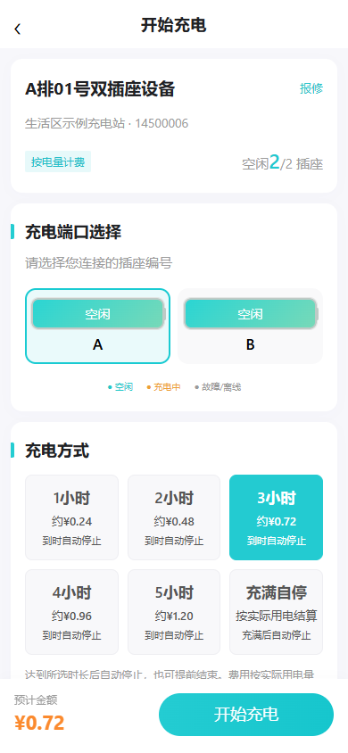 | 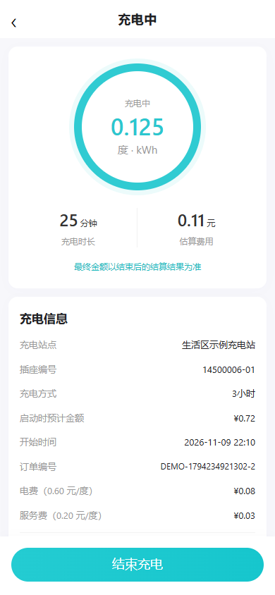 |
| **结束结算与模拟支付** | **我的充电订单** |
| 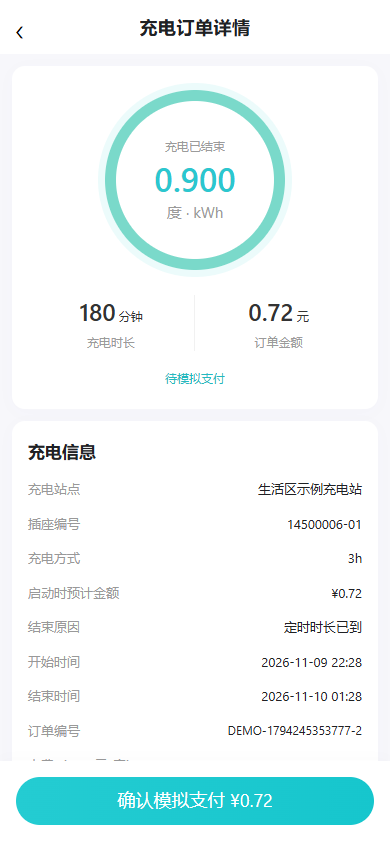 | 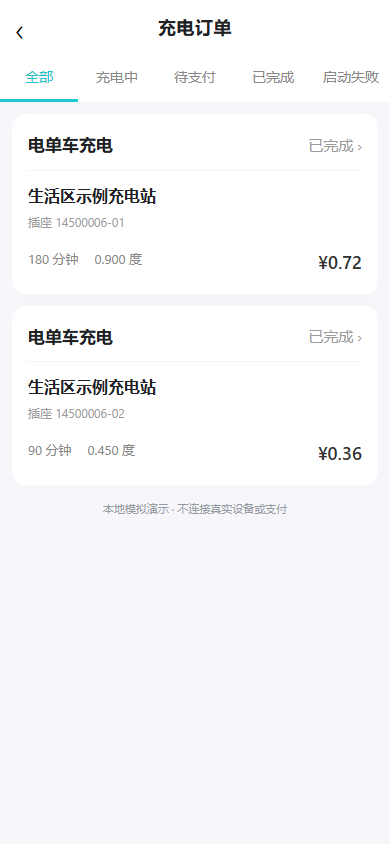 |
| **故障报修** | **个人中心** |
| 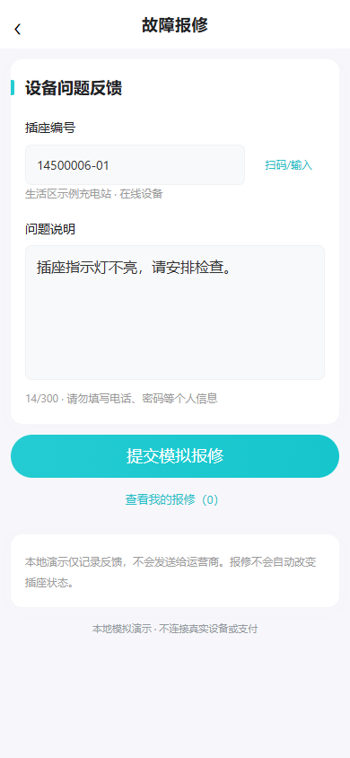 | 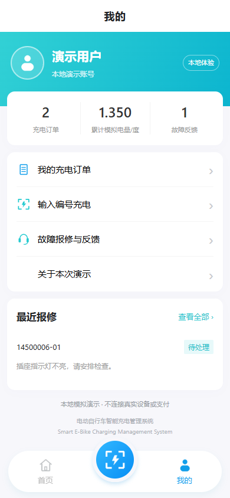 |

## 项目特点

- **面向两轮充电**：围绕电动自行车站点与独立插座组织页面，避免混用汽车车牌、车型等信息。
- **按现场排布管理**：站点下配置多排设备，每台设备 A、B 两个插座独立选择与计费。
- **充电过程可追溯**：展示启动状态、计费快照、充电进度、分项账单与订单记录。
- **兼顾使用与管理**：配套用户端完成找站、充电和反馈，管理端处理资源维护、运营查看与异常。

## 适用场景

| 场景 | 典型站点位置 | 管理需求 |
| --- | --- | --- |
| 校园 | 学生公寓、食堂、教学区、体育场馆附近 | 师生找站、插座使用、充电计费与设备报修 |
| 住宅小区 | 非机动车停车棚、集中充电区、楼栋周边规划区域 | 居民充电、空闲插座查询、订单结算与物业维护 |
| 园区 | 员工停车区、办公楼配套停车棚、生活配套区 | 员工充电、站点设备管理、运营统计与异常处理 |

各场景共用站点、设备排、A/B 插座、费率、订单和报修流程，可按实际场地维护站点名称、位置与设备排布。当前默认演示数据以校园为例。

## 功能模块

新版方案、扫码、运营功能与已有数据库升级步骤见 [充电方案与运营增强](docs/charging-operations.md)。

### 功能结构图


<details>
<summary>查看 功能结构图 的可编辑图源</summary>

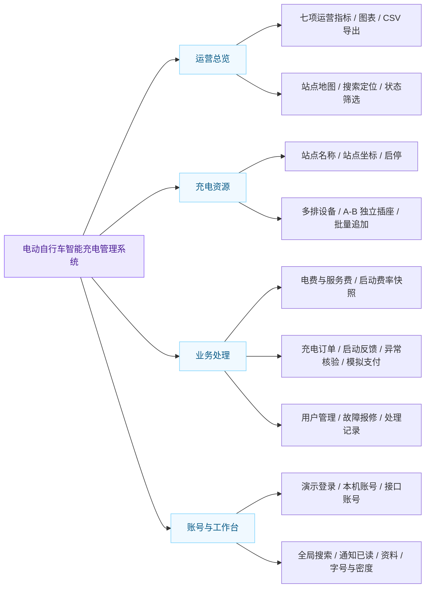

</details>

### 模块说明

| 模块 | 已实现能力 |
| --- | --- |
| 数据统计 | 七项运营指标、订单趋势、用户增长、费用统计、设备状态与插座占比、CSV 导出 |
| 站点地图 | 站点选择、搜索定位、状态筛选、设备与报修跳转；配置高德后支持底图缩放和拖动 |
| 站点管理 | 新增、编辑、启停；高德地图选点、地点搜索、拖动定位及地址回填；关联设备查看 |
| 设备与插座 | 现场排布/设备列表切换；按站点查看多排；新增排、逐台或批量追加；A/B 状态独立 |
| 收费规则 | 电费与服务费分开维护；订单保存启动时费率快照 |
| 充电订单 | 条件筛选、启动结果反馈、分项费用、模拟计量、结束与模拟支付、异常核验 |
| 用户管理 | 演示普通用户查询及启停，不包含代理商与多租户 |
| 故障报修 | 联网管理员分派、运营员处理本人工单、处理时间线；结案与插座恢复分别维护 |
| 运营与告警 | 场景/日期筛选、结算金额与电量趋势、启动时段、站点占用率、告警核对记录 |
| 用户端增强 | 1h / 2h / 3h / 充满自停 / 自定义、H5图片与摄像头扫码、消息中心、收藏和最近浏览 |
| 顶部工具 | 全局搜索、通知与已读状态、全屏、字号与密度、资料设置 |
| 本机账号服务 | Spring Boot 登录、CSRF 防护、Cookie 会话、资料、偏好、改密与退出 |

## 技术与架构

| 层次 | 技术 | 职责 |
| --- | --- | --- |
| 页面 | Vue 3.5、原生 CSS | 后台布局、表单、排布与状态交互 |
| 构建 | Vite 6 | 本地开发、生产构建、GitHub Pages 子路径资源 |
| 可视化 | ECharts 5.6 | 运营图表 |
| 地图 | 高德 JavaScript API 2.0（可选） | GCJ-02 底图与标记 |
| 独立账号服务 | Java 17、Spring Boot 3.5、Spring Security、JDBC、H2 | 本机账号与偏好持久化 |
| 发布 | GitHub Actions、GitHub Pages | 自动测试、构建及静态部署 |

### 系统架构图


<details>
<summary>查看 系统架构图 的可编辑图源</summary>

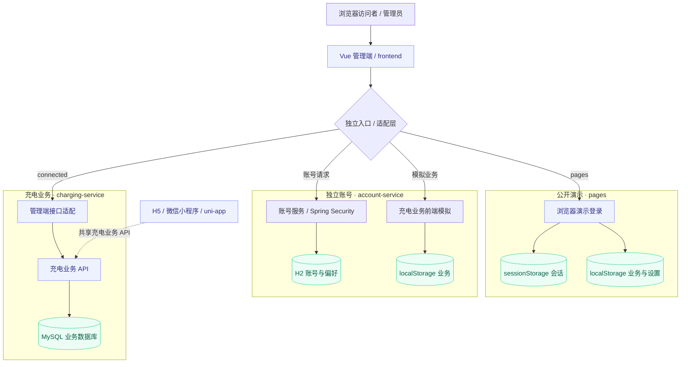

</details>

管理端位于 `frontend/`，两个后端服务位于 `backend/`，H5／小程序位于 `uni-app/`。代码在同一仓库，运行与存储仍按模式隔离。

“Vue + Vite”是前端技术组合；完整联网业务还需要独立后端。Pages 不运行 Java，也不会代替充电业务服务器。

## 业务交互流程

下图对应本仓库的管理端软件模拟流程。设备反馈、计量与支付均为演示操作；外部业务接口模式以服务器返回结果为准。


<details>
<summary>查看 业务交互流程图 的可编辑图源</summary>

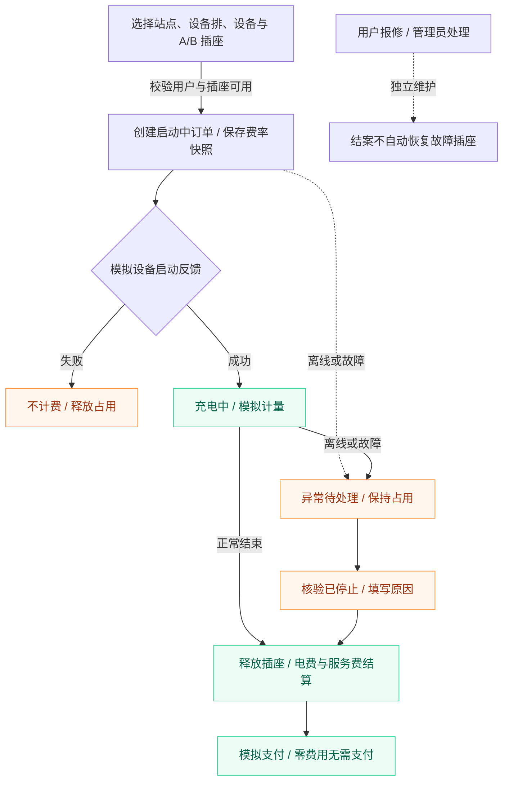

</details>

- **启动占用**：插座从“启动中”开始占用，同一插座不能重复创建活动任务。
- **费率快照**：启动时保留电费与服务费，修改现行费率不会回算历史订单。
- **异常处理**：设备离线或故障后保持异常占用，核验已停止并填写原因后才释放。
- **报修独立**：报修结案不自动清除插座故障，故障恢复需要单独确认。

## 快速开始

### 本地管理演示

需要 Node.js 22：

```bash
git clone https://github.com/ifox-hu/campus-ebike-charging-admin.git
cd campus-ebike-charging-admin/frontend
npm ci
npm run dev:pages
```

默认端口 5207，演示账号 `demo` / `Demo@123456`。本机账号模式可在仓库根目录运行 `./scripts/dev-admin.ps1`，账号服务与管理端默认端口为 8092 / 5195。

### H5 与微信小程序

一份 uni-app 源码生成两端，不维护重复的 H5 工程：

```bash
cd uni-app
npm ci
npm run dev:h5
npm run build:mp-weixin
```

H5 默认端口 5197。微信开发者工具导入 `uni-app/dist/build/mp-weixin/`，AppID 在 `uni-app/src/manifest.json` 配置。编译通过不代表微信真机或正式发布验收。

### 业务后端与双端联调

1. 按 [配置说明](docs/configuration.md) 初始化独立开发 MySQL，填写 `backend/.env.local`。
2. 仓库根目录运行 `./scripts/dev-charging.ps1`，默认业务 API 8081。
3. 在 `frontend/` 运行 `npm run dev:connected`，默认管理端 5201。
4. 在 `uni-app/` 运行 `npm run dev:connected`，默认用户端 5198。

显式 `graduation` 模式的新库会创建 `graduation_admin` / `DemoAdmin2027!` 及 `graduation_user` / `DemoUser2027!`。已有站点、账号与密码不被初始化程序覆盖。

## 核心数据关系

下图描述 `frontend/src/domain/seed.js` 与 `frontend/src/domain/service.js` 中的前端演示业务模型。PK/FK 表示逻辑标识与关联，**不是声明这些业务实体已经存入 H2 或 MySQL**。每台设备恰好包含 A、B 两个独立插座；每个插座允许多条历史订单，但同一时间只能存在一笔活动任务。


<details>
<summary>查看 核心数据关系图 的可编辑图源</summary>

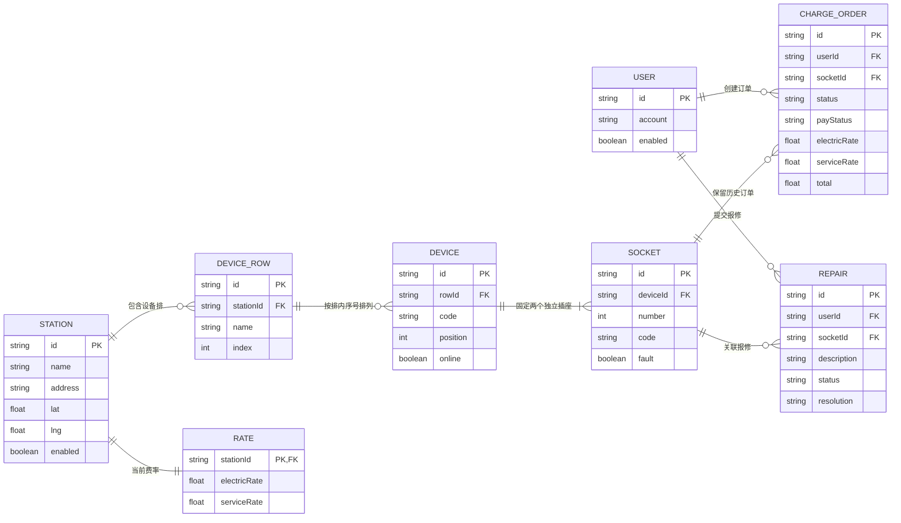

</details>

## 目录结构

```text
.github/workflows/       # 测试、构建与在线管理演示发布
frontend/                # Vue 管理端
  src/                   # 页面、地图、领域模型与 API 适配
  tests/                 # 领域与请求层测试
  e2e/                   # 浏览器验收与文档截图
backend/
  charging-service/      # Spring Boot 充电业务 API
    src/                 # 账号、站点、设备、插座、费率、订单、报修
    db/                  # 新库初始化与升级 SQL
  account-service/       # 可选的独立管理员账号服务
  compose.yaml           # 独立开发数据库
  .env.example           # 数据库配置模板
  pom.xml                # 后端聚合测试入口
uni-app/                 # H5 / 微信小程序共享工程
  src/pages/             # 找站、设备、充电、订单、报修、我的
  src/components/        # 共享组件与高德地图
  src/data/              # 演示目录数据
  tests/                 # 用户端领域与 API 测试
  e2e/                   # 充电方式浏览器验收
scripts/                 # 启动脚本
docs/                    # 架构、配置、测试、截图和图源
```

依赖、构建产物、`.env.local`、运行日志和账号数据库不纳入版本控制。旧过程记录、重复截图及跨工程验收脚手架已移除。

## 许可说明

Vue、Vite、ECharts、Spring Boot 等第三方组件遵循各自许可证。

当前仓库尚未指定开源许可证。再分发或商用前，请联系维护者确认授权。贡献与问题反馈见 [贡献说明](CONTRIBUTING.md)，漏洞报告见 [安全说明](SECURITY.md)。
