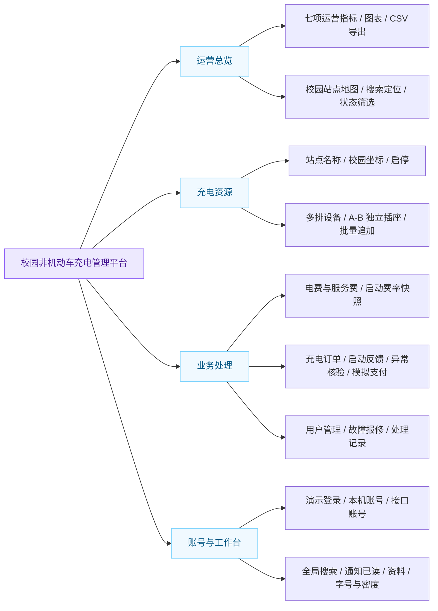
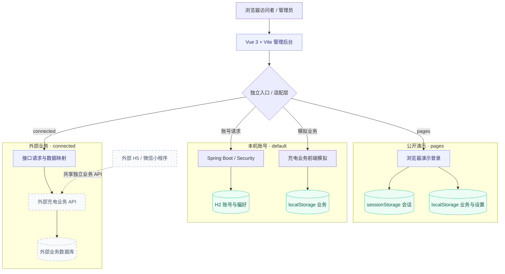
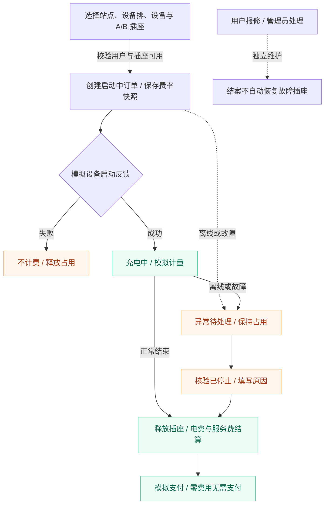
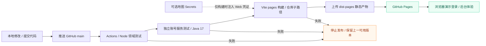
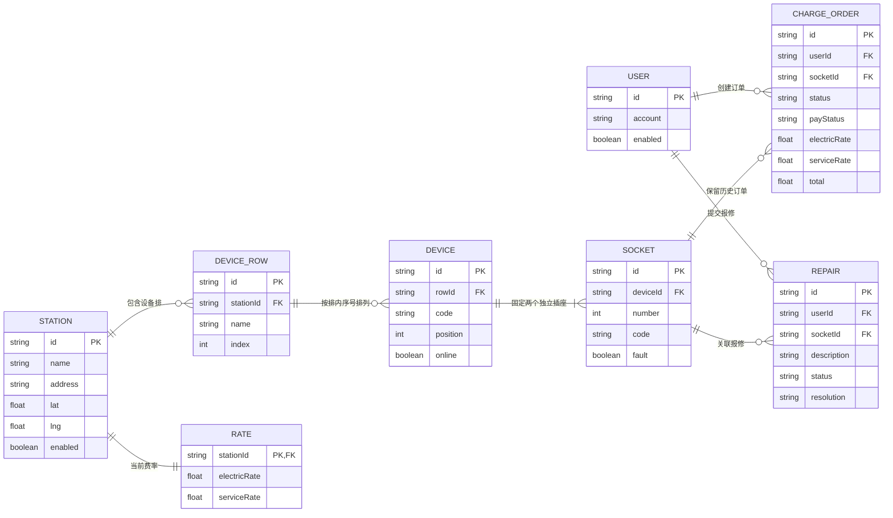

# 校园非机动车充电管理平台

[](https://github.com/ifox-hu/campus-ebike-charging-admin/actions/workflows/pages.yml)


面向校园电动自行车集中充电场景的毕业设计管理端，采用 **Vue 3 + Vite + ECharts**。站点按“**站点 → 多排设备 → 每台设备两个独立插座 A/B**”组织。

**[在线演示](https://ifox-hu.github.io/campus-ebike-charging-admin/) · [部署说明](docs/deployment.md) · [问题反馈](https://github.com/ifox-hu/campus-ebike-charging-admin/issues)**

> 在线页面是公开静态演示，演示账号 `demo`、密码 `Demo@123456`（仅模拟登录流程，并非真实身份认证）；业务、资料、通知与设置只保存在访问者自己的浏览器，不控制真实充电设备，不发生真实付款。
>
> 本仓库包含管理前端及独立的 Spring Boot 管理员账号服务。统一充电业务后端、H5/微信小程序不包含在本仓库；接口适配客户端与本地模拟版分开运行。

## 目录

- [项目预览](#项目预览)
- [功能模块](#功能模块)
- [技术与架构](#技术与架构)
- [业务交互流程](#业务交互流程)
- [快速开始](#快速开始)
- [运行模式](#运行模式)
- [GitHub Pages 部署](#github-pages-部署)
- [校园站点与数据](#校园站点与数据)
- [核心数据关系](#核心数据关系)
- [目录结构](#目录结构)
- [测试验证](#测试验证)
- [常见问题](#常见问题)
- [当前边界](#当前边界)
- [参考与授权](#参考与授权)

## 项目预览

演示账号：**`demo` / `Demo@123456`**。登录页支持填入演示账号、显示密码、记住账号与退出登录。

| 在线演示登录 | 运营数据统计 |
| --- | --- |
|  |  |
| **设备排布与 A/B 插座** | **本机配置高德后的校园地图** |
|  |  |

未配置地图凭证时，在线演示使用已保存校园坐标绘制示意图，明确标注非真实底图。地图截图为本机配置高德 Web Key 后的效果，不表示在线站点已启用地图服务。

## 功能模块

### 功能结构图


<details>
<summary>查看 功能结构图 的可编辑图源</summary>



</details>

### 模块说明

| 模块 | 已实现能力 |
| --- | --- |
| 数据统计 | 七项运营指标、订单趋势、用户增长、费用统计、设备状态与插座占比、CSV 导出 |
| 校园站点地图 | 站点选择、搜索定位、状态筛选、设备与报修跳转；配置高德后支持底图缩放和拖动 |
| 站点管理 | 新增、编辑、启停、地址与 GCJ-02 坐标；关联设备查看 |
| 设备与插座 | 现场排布/设备列表切换；按站点查看多排；新增排、逐台或批量追加；A/B 状态独立 |
| 收费规则 | 电费与服务费分开维护；订单保存启动时费率快照 |
| 充电订单 | 条件筛选、启动结果反馈、分项费用、模拟计量、结束与模拟支付、异常核验 |
| 用户管理 | 演示普通用户查询及启停，不包含代理商与多租户 |
| 故障报修 | 待处理/已处理、填写处理结果；报修结案与插座恢复分别维护 |
| 顶部工具 | 全局搜索、通知与已读状态、全屏、字号与密度、资料设置 |
| 本机账号服务 | Spring Boot 登录、CSRF 防护、Cookie 会话、资料、偏好、改密与退出 |

## 技术与架构

| 层次 | 技术 | 职责 |
| --- | --- | --- |
| 页面 | Vue 3.5、原生 CSS | 后台布局、表单、排布与状态交互 |
| 构建 | Vite 6 | 本地开发、生产构建、GitHub Pages 子路径资源 |
| 可视化 | ECharts 5.6 | 运营图表 |
| 地图 | 高德 JavaScript API 2.0（可选） | GCJ-02 底图与标记 |
| 独立账号服务 | Java 17、Spring Boot 3.5、Spring Security、JDBC、H2 | 本机账号与偏好持久化 |
| 发布 | GitHub Actions、GitHub Pages | 自动测试、构建及静态部署 |

### 系统架构图


<details>
<summary>查看 系统架构图 的可编辑图源</summary>



</details>

图中实线表示本仓库的实际调用；外部业务 API、数据库及 H5/微信小程序为独立部署部分。三个运行模式通过独立入口与适配层切换，不混用数据。

“Vue + Vite”是前端技术组合；完整联网业务还需要独立后端。Pages 不运行 Java，也不会代替充电业务服务器。

## 业务交互流程

下图对应本仓库的管理端软件模拟流程。设备反馈、计量与支付均为演示操作；外部业务接口模式以服务器返回结果为准。


<details>
<summary>查看 业务交互流程图 的可编辑图源</summary>



</details>

- **启动占用**：插座从“启动中”开始占用，同一插座不能重复创建活动任务。
- **费率快照**：启动时保留电费与服务费，修改现行费率不会回算历史订单。
- **异常处理**：设备离线或故障后保持异常占用，核验已停止并填写原因后才释放。
- **报修独立**：报修结案不自动清除插座故障，故障恢复需要单独确认。

## 快速开始

### 仅体验静态演示

需要 **Node.js 22 LTS、npm**；无需 Java、数据库或地图 Key。

```bash
git clone https://github.com/ifox-hu/campus-ebike-charging-admin.git
cd campus-ebike-charging-admin
npm ci
npm run dev:pages
```

打开终端显示的地址，默认 `http://127.0.0.1:5207/`，先使用演示账号登录。

### 运行本机账号服务版

另需 **Java 17、Maven 3.9+**。使用两个终端：

```bash
# 终端一
cd server
mvn spring-boot:run
```

```bash
# 终端二：仓库根目录
npm ci
npm run dev
```

前端默认 `http://127.0.0.1:5195/`，账号服务默认仅监听 `127.0.0.1:8092`。

首次初始化示例账号为 `admin` / `Admin@123456`。仅用于本机开发；可通过 `EBIKE_ADMIN_USERNAME`、`EBIKE_ADMIN_PASSWORD` 设置初始化值，已有账号不会被重新覆盖。公开 Pages 不使用这组账号。

Windows 也可在根目录执行 `./启动界面复刻.ps1`，由脚本检查依赖和启动本机服务。账号数据库位于 `server/runtime/`，不纳入版本控制。

## 运行模式

| 命令 | 用途 | 需要后端 | 输出 |
| --- | --- | --- | --- |
| `npm run dev:pages` | 浏览器独立演示 | 否 | 开发服务 5207 |
| `npm run build:pages` | 公开静态演示构建 | 否 | `dist-pages/` |
| `npm run preview:pages` | 检查静态构建结果 | 否 | 预览服务 5207 |
| `npm run dev` | 本机账号服务模式 | 独立账号服务 | 开发服务 5195 |
| `npm run build` | 本机账号模式前端构建 | 运行时需要 | `dist/` |
| `npm run dev:connected` | 已有业务后端接口适配 | 外部业务后端 | 开发服务 5201 |
| `npm run build:connected` | 接口适配前端构建 | 运行时需要 | `dist-connected/` |

本仓库的接口模式不包含业务后端部署程序，不会在接口失败后自动切换成演示数据。与统一业务后端的适配记录见 [联调说明](docs/backend-integration.md)。

## GitHub Pages 部署

### 自动发布流程



<details>
<summary>查看 自动部署流程图 的可编辑图源</summary>



</details>

仓库提供 [自动发布工作流](.github/workflows/pages.yml)。推送 `main` 后自动：

1. 安装 Node.js 22、Java 17 及依赖。
2. 运行前端领域测试和独立账号服务测试。
3. 使用 `pages` 模式构建，设置 `/<仓库名>/` 资源前缀。
4. 上传静态产物并部署到 GitHub Pages。

在仓库 **Settings → Pages → Source** 选择 **GitHub Actions**。可从 Actions 页面手动重新部署。Fork 后仓库名称由工作流自动读取，无需修改业务代码。

可选地图凭证在仓库 Actions Secrets 中设置 `AMAP_WEB_KEY` 和 `AMAP_SECURITY_CODE`；同时按高德控制台要求配置部署域名。未设置时使用校园坐标示意。构建不会自动将本机 `.env.local` 中的地图凭证带入 Pages。

详细步骤、自定义服务器、环境变量和回退方式见 [部署说明](docs/deployment.md)。

## 校园站点与数据

默认五站依据南阳师范学院官方校园 GIS 核对楼栋名称，再在高德实际底图上拾取楼旁室外道路；**点位为毕业设计演示规划，非实测充电设施清单**。点位来源、坐标与旧数据迁移见 [楼栋周边说明](docs/campus-building-locations.md)。

| 站点 | 排数 | 每排设备数 | 设备总数 | 独立插座 |
| --- | ---: | --- | ---: | ---: |
| 逸夫教学楼南侧 | 3 | 12、15、12 | 39 | 78 |
| 中区四公寓东侧 | 2 | 13、15 | 28 | 56 |
| 体育馆南侧 | 1 | 12 | 12 | 24 |
| 西区八公寓北侧 | 3 | 9、11、8 | 28 | 56 |
| 东升园餐厅南侧 | 2 | 10、12 | 22 | 44 |

配置固定保存，不会随刷新重新随机。默认共 129 台双插座设备、258 个插座；当前状态会根据浏览器内的演示操作变化。

- 计费示例：电费 0.60 元/kWh、服务费 0.20 元/kWh；结束后分项结算。
- 新任务保留启动时费率，修改当前费率不重算历史订单。
- 启动失败不计费；异常任务需核验处理，不会因设备恢复在线而自动释放。
- 旧演示数据可迁移校园坐标与排布，保留订单/报修关联；人工编辑的数据不强制覆盖。
- 业务存储键为 `ebike-graduation-admin-demo-v3`。公开演示修改只影响当前浏览器；不要录入真实人员或敏感业务数据。

## 核心数据关系

下图描述 `src/domain/seed.js` 与 `service.js` 中的前端演示业务模型。PK/FK 表示逻辑标识与关联，**不是声明这些业务实体已经存入 H2 或 MySQL**。每台设备恰好包含 A、B 两个独立插座；每个插座允许多条历史订单，但同一时间只能存在一笔活动任务。


<details>
<summary>查看 核心数据关系图 的可编辑图源</summary>



</details>

### 数据保存位置

| 数据 | 公开演示 pages | 本机账号模式 | 外部接口模式 connected |
| --- | --- | --- | --- |
| 站点、设备、插座、费率、订单、报修 | 当前浏览器 localStorage | 当前浏览器 localStorage | 外部业务 API 与其数据库 |
| 登录状态 | 当前标签页 sessionStorage 中的演示会话 | Spring Security / Cookie 会话 | 页面内存中的业务令牌 |
| 管理员资料、显示偏好、通知已读 | 当前浏览器 localStorage | H2：账号表与通知已读表 | 按已接入的服务端接口展示 |
| 真实设备控制与真实支付 | 未接入 | 未接入 | 不因连接 API 就视为已完成真实接入 |

独立账号服务仅包含 `eb_admin_accounts` 与 `eb_admin_notice_reads` 两张持久化表，建表语句见 [schema.sql](server/src/main/resources/schema.sql)。图表、调用边界及代码对应关系见 [架构说明](docs/architecture.md)。

## 目录结构

```text
.github/workflows/      # 测试、构建与 Pages 发布
src/
  components/           # 仪表盘、站点地图、业务表单、排布、订单及顶部工具
  domain/               # 数据模型、计费规则、迁移、统计、搜索、通知
  services/             # 本机账号请求、公开演示适配、高德加载
  connected/            # 外部统一业务后端适配客户端
  runtime.js            # 显式运行模式
server/
  src/main/             # 独立管理员账号服务及数据库表结构
  src/test/             # 隔离内存数据库测试
tests/                  # Node.js 领域规则测试
qa/                     # 可选的浏览器验收脚本
docs/
  diagrams/             # 五张图的 Mermaid 可编辑源文件
  screenshots/          # 本项目实际页面截图
  architecture.md       # 图表对应的代码与数据边界
  deployment.md         # Pages、本机与外部接口部署
  testing.md            # 自动测试与浏览器验收
```

## 测试验证

```bash
npm ci
npm test
npm run build
npm run build:pages
npm run build:connected
mvn -B -f server/pom.xml test
```

浏览器脚本为可选验收工具，需要本机 Playwright 与 Microsoft Edge，不是业务运行依赖：

- `qa/verify-pages.cjs`：登录与错误密码、同标签页会话恢复、退出后刷新、移动端布局、子路径资源、通知与偏好持久化。
- `qa/verify-station-layouts.cjs`：五个站点排布差异、即时切换、列表统计一致性。
- `qa/verify-dashboard-map.cjs`：地图选择、筛选、设备/报修跳转及断网回退。
- `qa/verify-map-interactions.cjs`：已配置真实高德时的缩放、拖动、搜索与定位。

命令说明及浏览器依赖安装见 [测试说明](docs/testing.md)。最新可重复的自动测试状态以 Actions 记录为准。

## 常见问题

**在线演示用什么账号？是否为真实身份认证？**

使用 `demo` / `Demo@123456`，也可点击“填入演示账号”后登录。公开页面仅模拟登录流程，密码不保存到浏览器存储，也不发送到账号服务器；同一标签页刷新保留会话，退出后重新打开需要登录。本机 `npm run dev` 模式才连接独立 Spring Boot 账号服务，二者账号不通用。

**为什么没有高德底图？**

默认未将本机地图凭证发布到公网。示意图仍支持站点选择和业务跳转；启用真实底图需配置自己的 Web Key 和对应部署域名。

**为什么选择站点后排布没有改变？**

当前现场排布模式已改为选择后即时更新；如仍显示旧代码，请刷新页面确认部署版本。

**为什么换浏览器后看不到修改？**

演示数据只保存在当前浏览器，不是服务器共享数据库。清除站点存储会丢失本机演示修改。

**能否直接接真实充电设备和微信/支付宝付款？**

当前不具备这些能力。真实接入需要设备协议、服务端事务、支付资质与回调、安全校验等配套实现。

## 当前边界

- 无真实设备控制、计量检定、微信/支付宝扣款、退款或资金结算。
- 无预约占位、IC 卡、代理商、多租户、促销与分账。
- 独立账号服务使用 H2；充电演示业务没有迁移到 MySQL。
- 不把界面上可点击的演示流程当作真实硬件或线上支付验收。
- 静态模式不是生产鉴权方案；不要将其用于真实运营后台。
- 用户端、微信小程序、充电业务后端的后续集成独立推进。

## 参考与授权

界面与 README 的组织方式参考 [慧知充电平台](https://github.com/roinli/HUIZHI-ChargeOS-cloud) 及其 [项目介绍文章](https://cloud.tencent.com/developer/article/2691703)。本项目为按毕业设计需求独立编写、简化业务的管理端，**不声称拥有上游商业版源码或完整商业能力**，与上游维护方无隶属关系。

校园楼栋周边点位见 [最新点位说明](docs/campus-building-locations.md)，范围修正历史见 [校园坐标说明](docs/campus-map-location-fix.md)。Vue、Vite、ECharts、Spring Boot 等组件按各自许可证使用；参考项目的许可证不自动适用于本仓库的独立代码。

当前仓库尚未指定开源许可证。需要再分发或商用时，请先联系维护者确认授权。提交问题前请阅读 [贡献说明](CONTRIBUTING.md) 和 [安全说明](SECURITY.md)。
