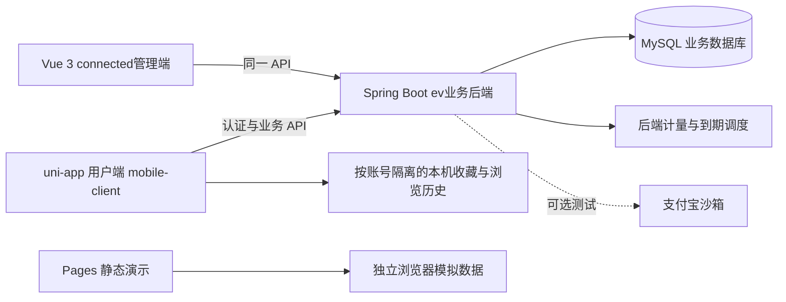
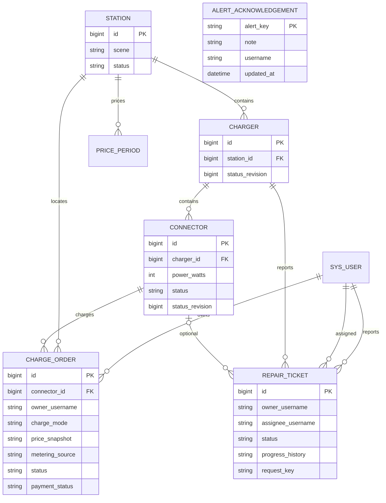
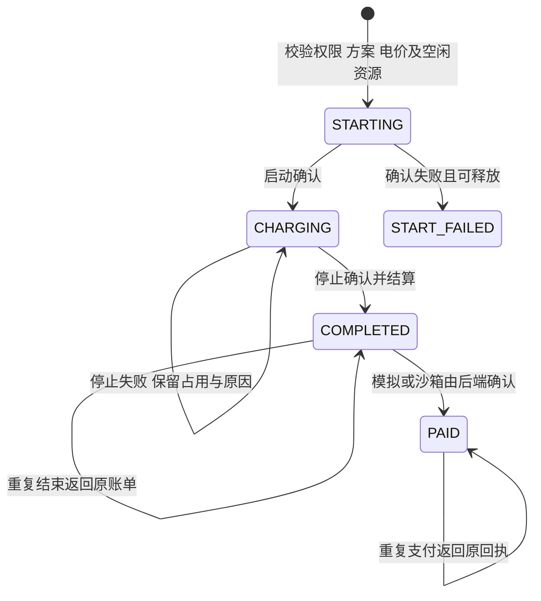
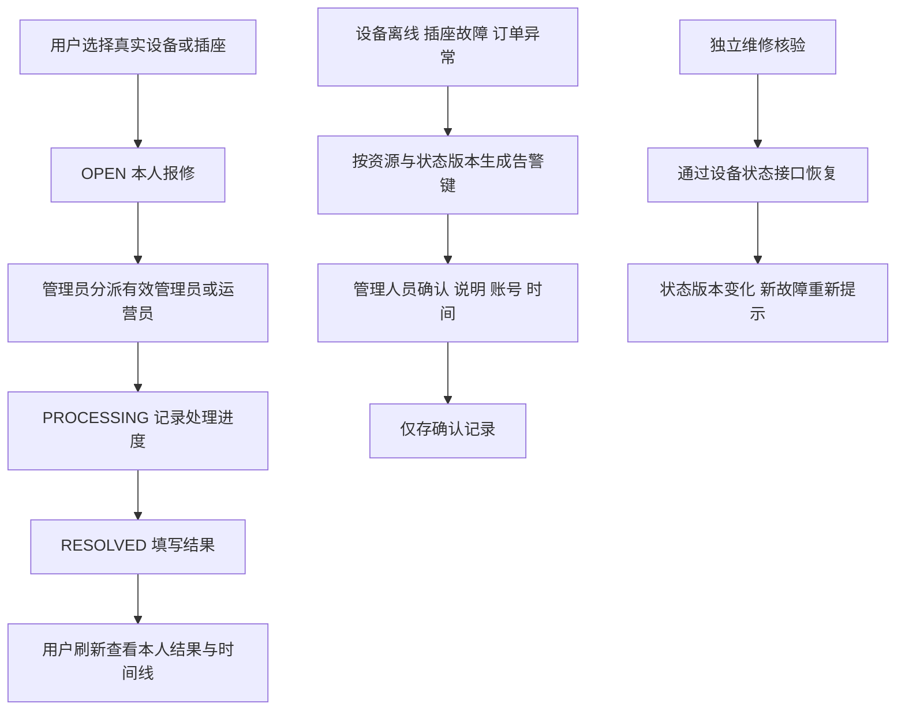

# 联机架构与业务状态

管理端与用户端共用业务 API。设备排保存在管理目录中，订单和工单通过业务数据库 ID 关联资源。

## 系统架构

自动测试使用 H2 数据库，部署使用 MySQL。Pages 演示数据保存在浏览器。

## 数据关系

布局目录与业务资源通过 `management_catalog_link` 映射，历史订单保存名称、功率及价格快照。

## 订单与支付

充电状态和支付状态分别保存。图中 PAID 表示支付完成，此时订单的充电状态为 COMPLETED。定时与软件 FULL 订单由后端按截止时间结算，两端显示结束原因和计量来源。

## 报修与告警

报修结案、告警确认和故障恢复是三个独立动作。运营员只处理分派给本人的报修，不能修改基础设备配置；管理员负责配置恢复。
