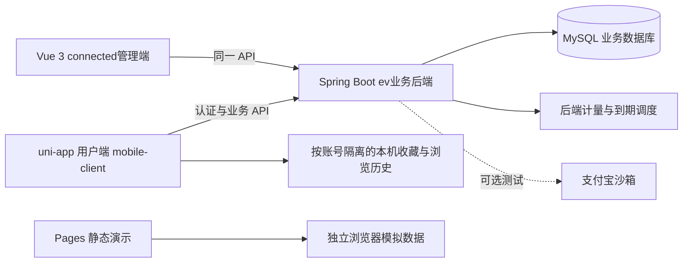
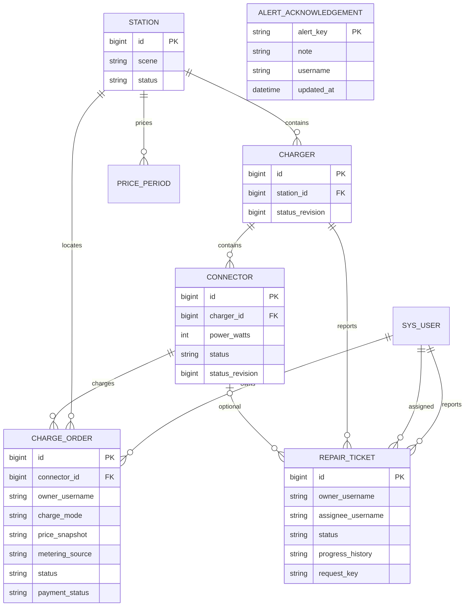
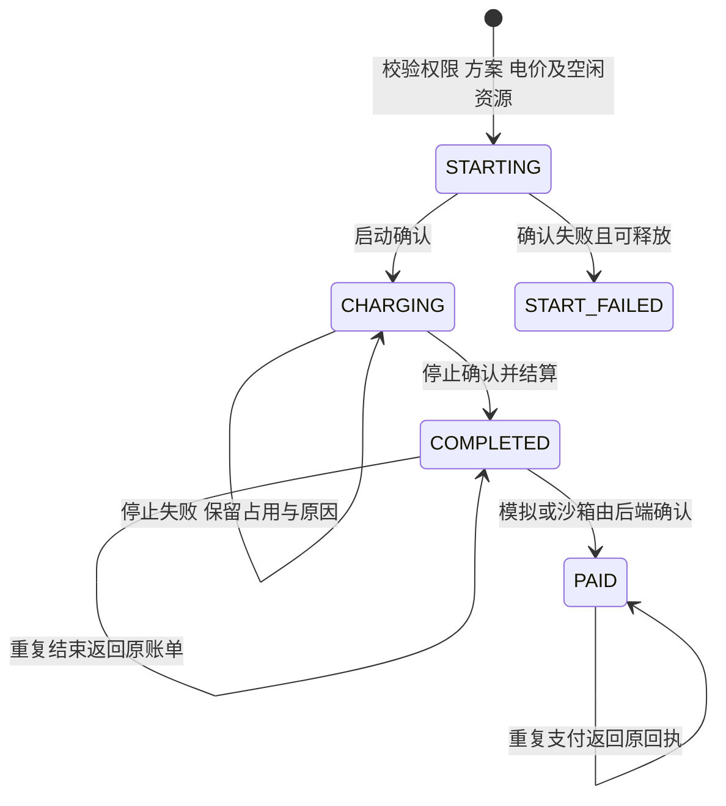
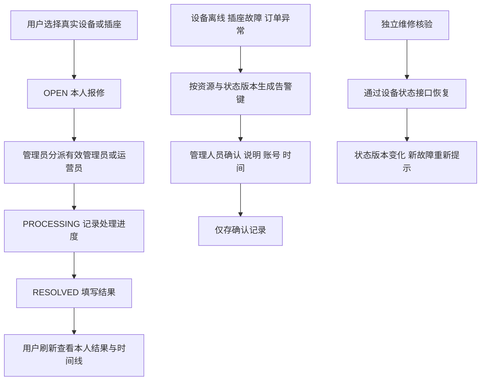

# 最终联机架构与业务状态

图示对应本轮选定实现。设备排为管理目录中的布局元数据；订单和工单使用业务数据库ID，不能以演示目录外部ID代替。

## 系统架构

自动验收用H2替代MySQL，验证业务及权限；MySQL升级和真实部署是另一个验收环节。Pages与业务数据库没有同步箭头。

## 数据关系

关联是业务层及数据模型关系，不表示所有字段都已建立物理外键。布局目录与业务资源通过`management_catalog_link`映射；历史订单保存名称、功率及价格快照。

## 订单与支付

PAID为支付状态示意，数据库订单充电状态仍为COMPLETED，支付状态单独保存。定时和软件模拟FULL走后端截止时间；结束原因与计量来源在两端展示。TCP真实电池充满检测未纳入本轮。

## 报修与告警

报修结案、告警确认和故障恢复是三个独立动作。运营员只处理分派给本人的报修，不能修改基础设备配置；管理员负责配置恢复。
